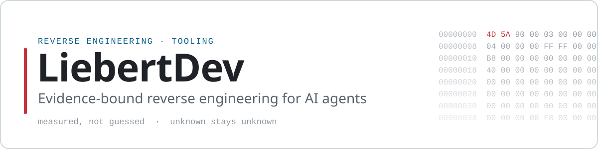
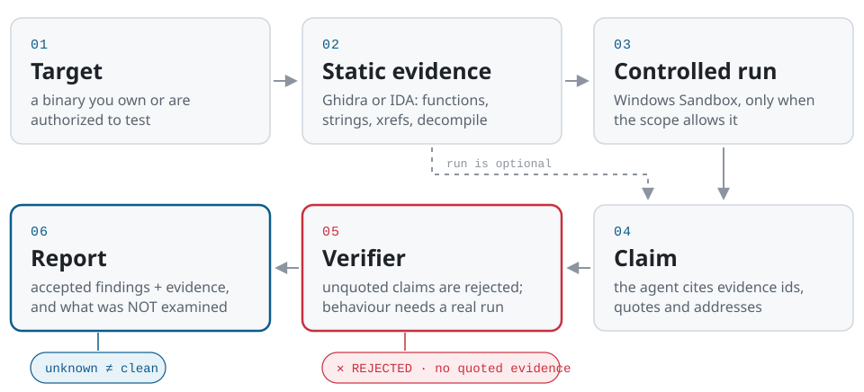

<picture>
  <source media="(prefers-color-scheme: dark)" srcset="assets/banner-dark.svg">
  <source media="(prefers-color-scheme: light)" srcset="assets/banner-light.svg">
  
</picture>

I build reverse-engineering tools that AI agents can drive without making things up.
The rule is simple: a finding is backed by quoted evidence, or it is not a finding.
Anything that was not examined is reported as not examined, never as "clean".

## Featured: Red Harness

**[LiebertDev/red-harness](https://github.com/LiebertDev/red-harness)** is an evidence-bound reverse-engineering harness,
exposed as an MCP server for Claude Code, Codex and other MCP clients.
It is meant for binaries you own or are authorized to test.

<picture>
  <source media="(prefers-color-scheme: dark)" srcset="assets/red-harness-flow-dark.svg">
  <source media="(prefers-color-scheme: light)" srcset="assets/red-harness-flow-light.svg">
  
</picture>

- **Static analysis** through Ghidra or IDA: functions, strings, cross-references, decompilation, disassembly, raw bytes.
- **Claim verifier:** every claim must cite evidence; a claim that is not backed by quoted evidence is rejected.
- **Behaviour is proven by running it:** a behaviour claim needs a controlled run in Windows Sandbox. A value seen in code is not proof.
- **Honest reports:** the report lists what was *not* examined, so a gap stays a gap.

| Edition | License | Status |
|---|---|---|
| **Core** | Apache-2.0 | public release in preparation at [LiebertDev/red-harness](https://github.com/LiebertDev/red-harness) |
| **Pro** | commercial | available; ask through an issue in the Core repository |

## Other projects

- **[liebert-reverse-engineering](https://github.com/LiebertDev/liebert-reverse-engineering)**:
  a static reverse-engineering CLI with JSON output, built to be driven by an AI agent.
  It wraps Detect It Easy, rizin, YARA-X, IDA, Ghidra and Unicorn; a value it cannot determine stays `UNKNOWN`.
  Python · Apache-2.0 · alpha
- **[LiDPI](https://github.com/LiebertDev/LiDPI)**:
  a one-click DPI circumvention tool for Windows, for Discord and blocked sites.
  System-wide mode through WinDivert or a driver-free browser-only proxy, with DNS over HTTPS.
  C# · WPF · MIT · v1.1.2

## Toolbox

| Area | Tools |
|---|---|
| Reverse engineering | Ghidra, IDA Pro, rizin, YARA-X, Detect It Easy, Unicorn, Capstone |
| Windows | PE format, kernel-driver triage, Windows Sandbox, WinDivert |
| Agents | Model Context Protocol (MCP) servers, Claude Code, Codex |
| Languages | Python, C# / .NET (WPF) |

## Contact

Questions, bug reports and Pro inquiries: open an issue in the relevant repository.
For security reports, follow the repository's `SECURITY.md` where one exists.
