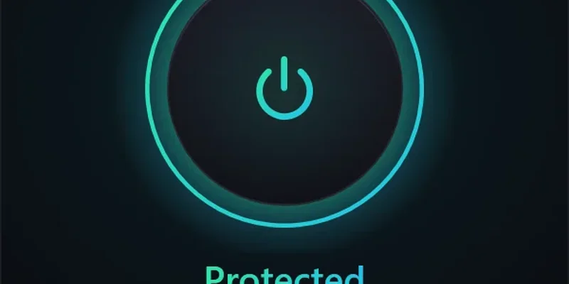

Liebert builds Windows-first reverse-engineering tooling and small Windows utilities. The guiding principle is **unknown stays unknown**: a result is either measured or it is marked as such, never guessed.

## Projects

<table>
  <tr>
    <td width="50%" valign="top">
      
      <h3><a href="https://github.com/LiebertDev/liebert-reverse-engineering">liebert-reverse-engineering</a></h3>
      
Static reverse-engineering CLI built to be driven by an AI model; every result is measured or marked UNKNOWN.

      
    </td>
    <td width="50%" valign="top">
      
      <h3><a href="https://github.com/LiebertDev/LiDPI">LiDPI</a></h3>
      
One-click Windows DPI tool for reaching Discord and blocked sites.

      
    </td>
  </tr>
</table>

## Toolbox

## Lab journal

Notes and write-ups: **[liebertdev.github.io/liebert-lab](https://liebertdev.github.io/liebert-lab/)**

---

**TR:** Liebert, Windows odaklı tersine mühendislik araçları ve küçük Windows yardımcı programları geliştirir. İlke şudur: bilinmeyen bilinmeyen kalır; her sonuç ya ölçülmüştür ya da öyle işaretlenir. Projeler ve günlük yukarıdaki bağlantılardadır.
